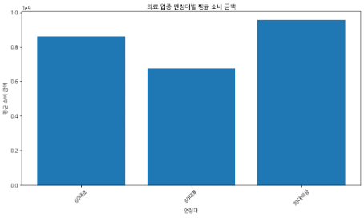
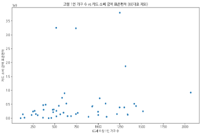
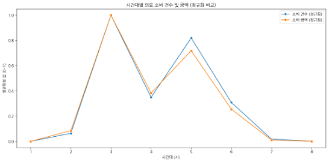
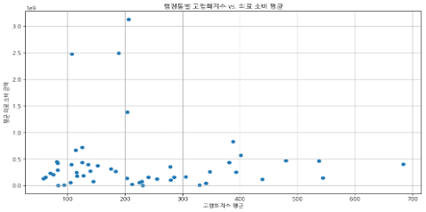
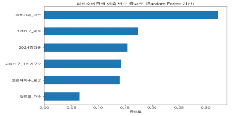
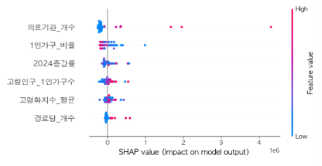

# 고령층 의료소비 양극화 분석과 행정동 기반 복지정책 타겟팅

성남시 50개 행정동의 **신한카드 고령층 소비 데이터**와 공공데이터(고령화지수, 1인 가구, 의료기관·경로당 수)를 결합해, 고령층 의료소비의 양극화 구조를 진단하고 정책 개입이 필요한 지역 유형을 나눈 프로젝트입니다.

- **공모전**: 2025 성남시 공공데이터 활용·분석 아이디어 공모전 (지정주제 3)
- **기간**: 2025.03 ~ 2025.06
- **형태**: 2인 팀 프로젝트

> **역할 구분**
> 이 저장소의 노트북은 제가 작성한 **데이터 전처리, 가설 1~4 검증, K-Means 군집 탐색** 코드입니다.
> 아래 [팀 결과](#팀-결과-군집-비교와-변수-중요도) 절의 DBSCAN, Random Forest·XGBoost + SHAP, 최종 5개 지역 유형 재정의는 팀원이 진행한 분석이며, 최종 제안서에 실린 결과를 정리했습니다. 해당 코드는 이 저장소에 없습니다.

## 리서치 질문

1. 고령층 의료소비의 양극화 현상은 실제로 존재하는가?
2. 고령 1인 가구 수와 의료소비 편차는 어떤 관계가 있는가?
3. 의료소비가 특정 시간대·시기에 집중되는가?
4. 행정동 단위로 정책 개입이 필요한 지역 유형을 구분할 수 있는가?

## 데이터

| 데이터 | 기준 | 출처 |
|---|---|---|
| 읍면동별 시간대별 카드 소비 금액·건수 (개인) | 2023~2024 | 신한카드 (공모전 제공) |
| 시군구별 일자별 카드 소비 금액·건수, 사용자 수 | 2023~2024 | 신한카드 (공모전 제공) |
| 동별 연령별 인구 (외국인 제외) | 2019~2023 | 통계청 |
| 성남시 인구 및 세대 현황, 1인 가구 현황 | 2020~2025 | 경기도 성남시 |
| 노인여가복지시설(경로당) 현황 | 2023 | 경기데이터드림 |
| 의료기관 현황 | 2023~2024 | 경기도 성남시 |

모든 데이터는 행정동 단위로 집계해 하나의 데이터셋으로 합쳤습니다. 주요 파생 변수는 다음과 같습니다.
- **의료소비**: 의료 업종 총 소비금액·건수, 1회 평균 소비금액, 전체 소비 대비 의료 비율
- **고령화**: 2019~2023 고령화지수 평균, 선형회귀로 추정한 2024년 고령 인구 증감률
- **인프라·가구**: 65세 이상 1인 가구 수, 의료기관 수, 경로당 수

## 분석 흐름

| 단계 | 노트북 | 내용 |
|---|---|---|
| 1 | [01_population_and_facilities](notebooks/01_population_and_facilities.ipynb) | 행정동별 인구·1인 가구·복지시설 현황 정리 |
| 2 | [02_card_consumption_eda](notebooks/02_card_consumption_eda.ipynb) | 카드 데이터 탐색: 연령대·성별·업종·요일·시간대별 소비 |
| 3 | [03_aging_index_trend](notebooks/03_aging_index_trend.ipynb) | 동별 고령화지수 계산과 2024년 추정 |
| 4 | [04_hypothesis_tests_and_clustering](notebooks/04_hypothesis_tests_and_clustering.ipynb) | 가설 1~4 검증, 군집 입력 데이터 구축, K-Means |

## 주요 결과

### 가설 1. 고령층 의료소비는 양극화되어 있다 → 대체로 지지



70대 이상은 평균 의료소비 금액이 가장 높지만 소비 건수의 표준편차도 가장 컸습니다. 소수가 집중적으로 소비하고 다수는 거의 이용하지 않는 구조로, 평균만 보고 정책을 짜면 실제 소외층을 놓칠 수 있습니다.

### 가설 2. 고령 1인 가구가 많은 동일수록 의료소비 편차가 크다 → 부분적으로 지지



| 방법 | 상관계수 | p-value | 해석 |
|---|---|---|---|
| Pearson | 0.21 | 0.14 | 선형 관계는 약하고 유의하지 않음 |
| Spearman | 0.38 | 0.006 | 순위 기준으로는 중간 정도의 양의 상관, 유의함 |

편차 상위 동은 구미동, 야탑1동, 서현1동, 금곡동, 성남동 순이었습니다. 1인 가구 수가 적어도 편차가 큰 동이 있어, 인구 규모보다 **소비 분포의 불균형**이 우선순위 판단에 더 중요하다고 봤습니다.

### 가설 3. 의료소비는 특정 시간대에 집중된다 → 지지



고령층 의료소비는 오전 9~12시에 몰리고 오후에는 급감했습니다. 오전 인력 집중 배치와 이동 지원, 오후 간단 진료 확대로 수요를 분산하는 방안을 제안했습니다.

### 가설 4. 월별 의료소비는 일정하다 → 건수는 지지, 금액은 기각

소비 건수는 월 26만~33만 건으로 안정적이었지만, 금액은 1월·10월에 급등하고 5월·8월에 낮았습니다. 시기별로 의료 바우처 예산을 탄력적으로 운용하는 근거로 활용했습니다.

### 고령화 ≠ 의료소비



수진1동(고령화지수 683.9), 태평1동(543.7), 상대원3동(438.7)처럼 고령화가 매우 높은데도 의료소비가 낮은 동이 있었습니다. 고령화지수만으로 복지 자원을 나누면 이런 의료소외 지역을 놓칠 수 있습니다.

## 팀 결과: 군집 비교와 변수 중요도

*아래는 팀원이 진행한 분석으로, 최종 제안서 내용을 정리한 것입니다.*

**K-Means와 DBSCAN 비교**
- K-Means(4개 군집)는 고령화·의료소비 수준으로 뚜렷한 군집을 만들었지만, 평균 기반이라 "고령화는 높고 소비는 낮은" 동이 다른 군집에 섞였습니다.
- DBSCAN은 "고령 1인 가구 밀집 + 인프라 부족" 지역(상대원3동, 수진1동 등)을 따로 잡아냈지만, 21개 동이 노이즈로 분류되어 행정적으로 해석하기 어려웠습니다.

**변수 중요도 (Random Forest, XGBoost + SHAP)**

<p>


</p>

행정동별 의료소비 금액을 예측했을 때 **의료기관 수**(중요도 0.33)가 가장 중요했고, **1인 가구 비율**이 뒤를 이었습니다. 고령화지수의 기여는 상대적으로 작았습니다.

**최종 5개 지역 유형**

두 군집 결과와 변수 중요도를 종합해, 정책 판단 기준으로 군집을 다시 정의했습니다.

| 유형 | 대표 행정동 | 특징 | 정책 방향 |
|---|---|---|---|
| 초고령 의료소외 지역 | 수진1동, 신흥1동, 신흥3동, 태평1동, 상대원3동 | 고령화↑ 소비↓ 인프라↓ | 방문 진료, 이동형 진료버스, 커뮤니티케어센터 |
| 의료활동 밀집 고령중심 지역 | 서현1동, 야탑1동, 금곡동, 구미동 | 소비↑ 의료기관↑ | 만성질환 통합관리, 복약 지도 |
| 젊은 일반형 주거지역 | 분당동, 수내1~3동, 판교동 | 고령화↓ 소비↓ | 디지털 헬스, 예방 중심 |
| 인프라 부족 소비 밀집지 | 금광1동, 정자2동, 신촌동 | 소비↑ 인프라↓ | 의원 유치 인센티브, 공공 야간진료소 |
| 외곽 고립형 지역 | 고등동, 복정동, 시흥동 | 인프라↓ 소비↓ | 원격진료, 순회 건강버스 |

## 한계

- **표본 크기**: 분석 단위가 행정동 50개라서 변수 중요도와 군집 결과가 불안정할 수 있습니다.
- **최종 유형의 근거**: 5개 유형은 알고리즘 결과를 그대로 쓴 것이 아니라 분석 결과를 바탕으로 사람이 재정의한 것이라, 재현 가능한 기준을 문서화할 필요가 있습니다.
- **카드 데이터의 범위**: 신한카드 개인 결제만 포함되어 다른 카드사·현금 결제와 건강보험 급여분은 반영되지 않습니다. 의료소비가 낮다는 것이 곧 의료 이용이 적다는 뜻은 아닐 수 있습니다.
- **탐색 단계의 K-Means**: 04번 노트북의 K-Means는 행정동이 아니라 행정동×시간대×연령대 행 단위로 군집해, 팀 최종 결과(행정동 단위)와 분석 단위가 다릅니다.

## 폴더 구조

```
elderly-medical-polarization/
├── notebooks/   본인 작성 분석 노트북 (01 → 04)
├── images/      README 그림 (team_* 는 팀원 분석 결과)
├── archive/     샘플 파일 생성 등 보조 노트북
└── data/        원본 데이터 위치 (저장소에는 포함하지 않음)
```

## 사용 기술

Python, pandas, scikit-learn (K-Means, LinearRegression), SciPy, geopandas, matplotlib, seaborn
